# Architecture Notes — abeddys-ai-assistant

> Comprehensive architectural breakdown of the messaging, safety, escalation, persistence, and AI pipelines in `abeddys-ai-assistant`.

---

## 1. High-Level System Overview

`abeddys-ai-assistant` is an autonomous assistant designed to receive messages on WhatsApp (and planned for Instagram), pass them through a strict, deterministic rules-first safety layer, and either escalate sensitive/risky messages to the project owner (Abeddy) or generate safe, contextual, human-like automated responses.

### Tech Stack
- **Runtime & Language:** Node.js, TypeScript (Strict mode).
- **Messaging Interface:** `whatsapp-web.js` (running headless Chromium via Puppeteer with `LocalAuth` session management).
- **Data Persistence:** PostgreSQL (NeonDB) managed through Prisma ORM.
- **In-Memory Cache & Rate Limiting:** Redis via `ioredis` (daily per-contact rate limits with automatic midnight TTL).
- **AI Models:**
  - Google Gemini (`gemini-1.5-flash`) for Impersonator persona generation.
  - Anthropic Claude (`claude-3-5-sonnet-20241022`) with Gemini 1.5 Flash fallback for Tutor mode.
- **Deployment Target:** Railway.

---

## 2. End-to-End Message Lifecycle & Sequence

```mermaid
sequenceDiagram
    autonumber
    actor Sender as WhatsApp Sender
    participant WA as whatsapp-web.js Client
    participant DB as PostgreSQL (Prisma)
    participant Redis as Redis Cache
    participant Safety as Safety & Escalation Engine
    participant AI as AI Engine (Persona / Tutor)
    actor Owner as Abeddy (Owner)

    Sender->>WA: Incoming WhatsApp Message
    WA->>WA: Filter self-messages & group chats (@g.us)
    WA->>DB: Upsert Contact & Log Inbound Message
    
    WA->>Safety: Check Hard Safety Rules (KillSwitch, Blackout, Limits, URLs)
    alt Safety Rule Violates
        Safety-->>WA: Blocked (reason)
        WA-->>WA: Abort (No reply, logged to console)
    else Safety Passes
        WA->>DB: Query Active Priority Rules (Keyword Match)
        alt Keyword Rule Matches
            WA->>WA: Wait random delay (3-15s) & mark seen
            WA->>Sender: Send Predefined Rule Reply
            WA->>DB: Log Outbound Message & AutoReply (wasSent: true)
            WA->>Redis: Increment Daily Reply Count
        else No Keyword Match
            WA->>DB: Fetch last 10 messages for conversation context
            alt Contact Mode == TUTOR
                WA->>AI: Generate Tutor Reply (Claude 3.5 / Gemini)
            else Contact Mode == IMPERSONATOR
                WA->>Safety: Pre-flight Escalation Check (Group, Money, Location, Word Count)
                alt Escalation Triggered
                    Safety-->>WA: Flag for manual review (shouldFlag: true)
                else Pre-flight Passed
                    WA->>AI: Prompt Gemini 1.5 Flash (Sheng / Tone / Persona JSON)
                    AI-->>WA: JSON { reply, shouldFlag, reason }
                end
            end
            
            alt Message Flagged (shouldFlag: true)
                WA->>DB: Record AutoReply (wasSent: false, reason)
                WA-->>Owner: Escalated for Abeddy's review (No WhatsApp reply sent)
            else Reply Safe (shouldFlag: false)
                WA->>WA: Wait random delay (3-15s) & mark seen
                WA->>Sender: Send AI Reply
                WA->>DB: Log Outbound Message & AutoReply (wasSent: true)
                WA->>Redis: Increment Daily Reply Count
            end
        end
    end
```



---

## 3. The Rules-First Escalation Layer (Detailed Breakdown)

The core architectural tenet of this project is that **the LLM is never trusted to make safety or escalation decisions alone**. Deterministic, auditable code inspects and filters every single message before the LLM is invoked.

### 3.1 Tier 1: Hard Safety Gate (`safetyEngine.ts`)
Evaluated in sequence; the first failed check halts message processing:

1. **Global Kill Switch (`settings.killSwitch`):** When active, all automated responses are disabled immediately.
2. **Blackout Hours (`settings.blackoutStart` to `settings.blackoutEnd`):**
   - Supports same-day intervals (e.g., `01:00` to `06:00`).
   - Supports overnight intervals (e.g., `23:00` to `06:00`).
   - During blackout hours, bot refuses to auto-reply to preserve human-like rest patterns and sleep hygiene.
3. **Daily Rate Limit (`settings.dailyReplyLimit`):**
   - Checks Redis key `reply_count:<contactId>`.
   - Rejects if replies sent today `>= dailyReplyLimit` (default: 10).
   - Redis key automatically expires at midnight local time.
4. **URL Detection:**
   - Matches pattern `/https?:\/\/[^\s]+|www\.[^\s]+/i`.
   - Auto-blocks replies to messages containing links (anti-phishing, anti-spam, and preventing hallucinated reviews of untrusted links).
5. **Minimum Message Length:**
   - Rejects messages with fewer than 3 characters (`content.trim().length < 3`) to prevent replying to single punctuation marks or accidental keystrokes.

### 3.2 Tier 2: Static Keyword Rules (`prisma.rule`)
- Evaluated before conversational AI.
- Queried from Postgres ordered by `priority DESC`.
- Case-insensitive substring match against the incoming message body.
- If matched, sends deterministic static answer without spending LLM tokens or risking hallucinations.

### 3.3 Tier 3: Pre-Flight Escalation Checks (`personaEngine.ts`)
Deterministic business logic that checks for sensitive contexts before invoking the AI:

1. **Contact Group Restriction:**
   - Contacts categorized as `CLIENT` or `UNKNOWN` are **always escalated** (`shouldFlag: true, reply: null`). The bot never impersonates Abeddy to commercial clients or unverified contacts.
2. **Word Count Overflow:**
   - Messages exceeding 50 words (`split(/\s+/).length > 50`) are escalated to human review, as complex, long-form messages require genuine human comprehension.
3. **Financial / Money Requests:**
   - Evaluates Sheng and Kenyan English financial keywords: `ganji`, `doooh`, `okolea`, `niwai`, `nitakurefund`, `mpesa`, `nisendie`, `nipe`, `nisaidie pesa`.
   - **Exception:** If sender is offering/sending money (matches `nimekutumia`, `nimesend`, `pokea`, `sent you`, `sending you`), it does not escalate as a money demand.
   - Otherwise, strictly escalated (`shouldFlag: true`).
4. **Location Queries:**
   - Evaluates location inquiry patterns: `uko wapi`, `where are you`, `location yako`, `uko side gani`.
   - Never discloses user location automatically; strictly escalated.

### 3.4 Tier 4: LLM-Level Verification & Structured JSON Output
- If a message passes all deterministic pre-flights, the prompt instructs the model to return valid JSON with shape:
  ```json
  { "reply": "string | null", "shouldFlag": boolean, "reason"?: "string" }
  ```
- If the model determines during semantic reasoning that a question involves business commitments, meeting scheduling, or aggressive behavior, it returns `shouldFlag: true`.

---

## 4. Current Architectural Gaps & Vulnerabilities Identified

1. **Pre-Flight Logic Isolation & Leaks:**
   - The pre-flight escalation rules (money, location, word count, client group) currently live inside `personaEngine.ts` instead of `safetyEngine.ts`.
   - **Vulnerability:** When a contact is set to `TUTOR` mode (`tutorEngine.ts`), it completely bypasses these pre-flight checks! A student contact could ask for money, inquire about personal location, or paste URLs/links that bypass escalation in tutor mode.
2. **Lack of Automated Unit Tests:**
   - Zero test suites existed in the project. Unit tests must cover all boundary conditions for blackout hours (overnight vs same-day), rate limits, money keyword matching, and regex edge cases.
3. **Configuration & Environment Validation:**
   - Absence of schema validation on startup. Missing `GEMINI_API_KEY`, bad `DATABASE_URL`, or malformed ports can cause silent failures or runtime crashes.
4. **Tight Coupling to Live Databases in Safety Functions:**
   - `checkShouldReply` directly calls `prisma.settings.findUnique` and `getReplyCount(contactId)`. Decoupling the rule logic into pure rule evaluators enables testing of every rule permutation without needing mock DB connections.

---

## 5. Directory Structure & Key Files

```
backend/
├── prisma/
│   └── schema.prisma         # Postgres schema (Contact, Persona, Message, AutoReply, Rule, Settings)
├── src/
│   ├── ai/
│   │   ├── personaEngine.ts  # Impersonator engine (Gemini 1.5 Flash + Sheng/English Persona prompt)
│   │   └── tutorEngine.ts    # AI Tutor engine (Claude 3.5 Sonnet / Gemini fallback)
│   ├── lib/
│   │   ├── prisma.ts         # PrismaClient singleton
│   │   └── redis.ts          # Redis client and rate-limiting helpers
│   ├── safety/
│   │   └── safetyEngine.ts   # Core deterministic safety gate
│   ├── whatsapp/
│   │   └── whatsappClient.ts # whatsapp-web.js initialization and message dispatch loop
│   └── index.ts              # Express HTTP server, QR endpoints, graceful shutdown
├── package.json
└── tsconfig.json
```

---

## 6. Update — Unified Safety Gate (2026-11-27)

The gaps in section 4 are closed. Sections 2 and 3 describe the **old** order. The current pipeline (`src/pipeline/decideReply.ts`) is:

1. **Safety gate** (`src/safety/safetyEngine.ts`). Runs for every contact mode, before anything else.
   - **Tier 1, hard safety → BLOCK** (silent): kill switch, blackout hours (evaluated in `TZ`, default `Africa/Nairobi`), daily limit, links, messages under 2 characters.
   - **Tier 3, escalation → ESCALATE** (silent, logged, owner notified):

     | Rule | IMPERSONATOR | TUTOR |
     | --- | --- | --- |
     | CLIENT / UNKNOWN group | escalate | allowed (tutor mode is assigned on purpose) |
     | Over 50 words | escalate | allowed (study questions can be long) |
     | Money request (not an offer) | escalate | escalate |
     | Location question | escalate | escalate |

   - **Fails closed:** if Postgres or Redis can't be read, or the blackout settings are malformed, the message is blocked.
2. **Keyword rules (Tier 2).** These now run *after* the gate, so a keyword can no longer auto-answer a client, a stranger or a money request.
3. **AI engine for the contact's mode.**
   - Persona output is parsed with a zod schema (`parsePersonaOutput`). Gemini is asked for `application/json`, and code fences are stripped.
   - Anything malformed, or an empty reply, is **escalated** instead of sent.
   - An AI flag that still carries a suggested reply is escalated with that reply as a draft.

**Escalations:**
- They are recorded as `AutoReply { wasSent: false }`.
- When `OWNER_WID` is set, a summary goes to the owner's own WhatsApp: contact, reason, message and any suggested reply.
- The exception is a message escalated *only* because the contact is still `UNKNOWN`. It is logged without a ping, so unclassified numbers (spam, OTPs, businesses) don't bury real alerts.
- The handler ignores `fromMe` messages, so these notices never loop.

**Module layout:**

```
src/
├── safety/
│   ├── types.ts              # Shared types and the SafetyVerdict union
│   ├── rules/hardSafety.ts   # Pure Tier 1 rules (+ tests)
│   ├── rules/escalation.ts   # Pure Tier 3 rules (+ tests)
│   ├── safetyEngine.ts       # Coordinator with injected data access (+ tests)
│   └── liveSafety.ts         # Production wiring to Prisma + Redis
├── pipeline/decideReply.ts   # Gate → rules → AI decision, no side effects (+ tests)
└── whatsapp/whatsappClient.ts# Side effects only: DB writes, delays, sending, owner notice
```
